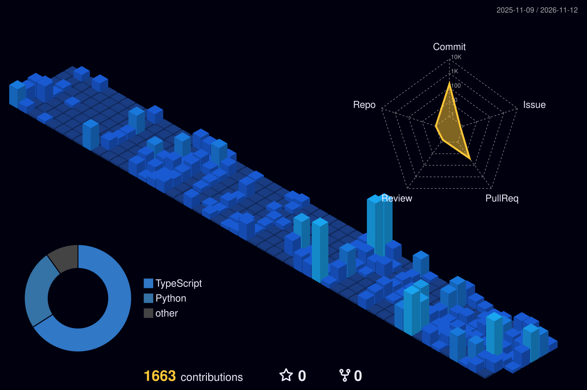

#  Hi, I'm Anthony Benacquisto

**Software engineer and computer science student building local-first memory for AI agents.**

I work on how AI coding assistants remember: what they should keep between sessions, how that knowledge stays scoped to the project it came from, and how a person can inspect and correct it. I care about software that stays understandable and under the user's control.

## What I'm Building

- 🧠 **[Tedd](https://github.com/AgentBigBrain/Tedd):** Persistent local memory for AI coding agents. Tedd gives Claude Code and Codex a private knowledge graph of people, projects, decisions, and evidence, with a bundled MCP server and an Obsidian view for reading it. This is where most of my time goes.
- 🛡️ **[AgentBigBrain](https://github.com/AgentBigBrain/AgentBigBrain):** A governance-first AI agent runtime in TypeScript, where typed contracts decide authority and receipts prove what happened. Tedd began inside it and was split out so it could ship on its own while the runtime keeps growing.

I also build web applications with Next.js and React, for clients through my business, Flare Web Design, and for fun on my own time: small sites and tools that exist because I wanted them to.

## Current Interests

`Agent Memory` · `Knowledge Graphs` · `Local-First Software` · `MCP` · `Claude Code & Codex` · `Agent Governance` · `Web Applications`

